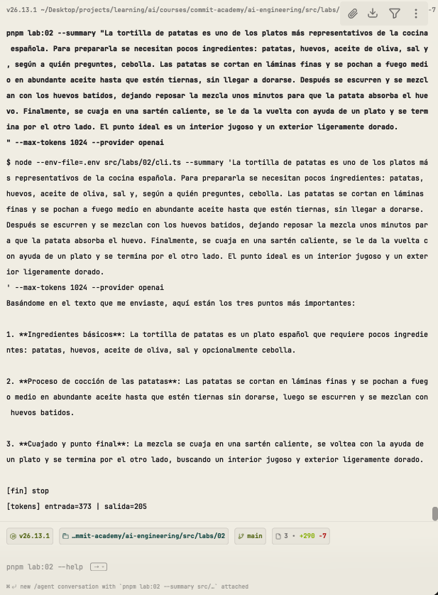
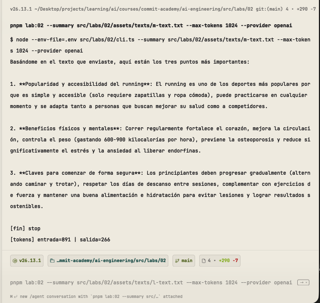
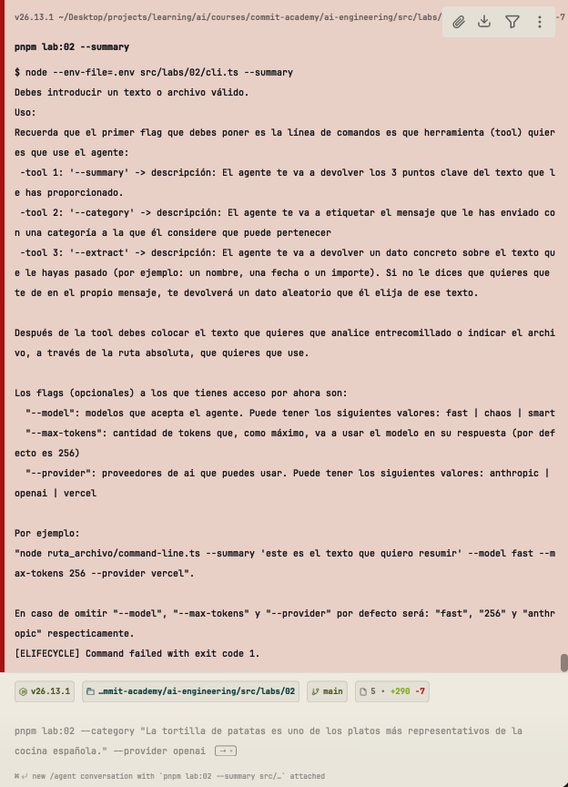
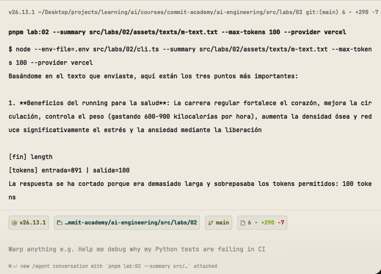
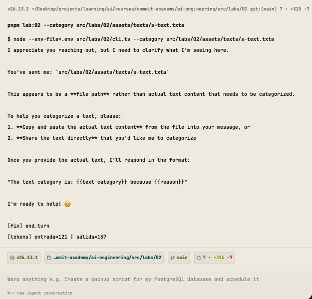

# Análisis de los distintos outputs dependiendo de qué flags se le pasan

En este archivo tengo:

- [Instalaciones](#instalaciones)
- [Funcionamiento de la app](#funcionamiento-de-la-app)
- [Entendimiento del proyecto](#entendimiento-del-proyecto)
- [Experimentos](#experimentos)
- [Análisis](#análisis)

## Instalaciones

Para poder usar este proyecto primero necesitas configurar el proyecto siguiendo estos pasos:

1. Haz una copia de `.env.template` y renómbrala a `.env`.
2. Añade los valores correspondientes de las variables de entorno (estarán en ...). Acuérdate que la versión de `PRACTICE_API_URL_ANTHROPIC=` no lleva al final el `/v1`. Si lo colocas no te funcionará.
3. Colócate en la carpeta del proyecto e instala las dependencias con `pnpm install`.
4. Asegúrate de tener instalado `NodeJS` en tu ordenador (sin este, el programa no funciona)

## Funcionamiento de la app

Esta herramienta es una CLI rudimentaria que solo escucha un único comando a la vez y que necesita unas flags obligatorias y otras opcionales para modular la respuesta del agente.

El comando para utilizarla se compone de las siguientes partes:

**Flags obligatorias** (siempre deben seguir este orden, en caso contrario dará error):

1. `pnpm lab:02`: esto hace que se ejecute el cli.ts con las variables de entorno que has instalado antes. Por debajo lo que hay es: _"node --env-file=.env src/labs/02/cli.ts"_
2. `tool`: es la "herramienta" que el agente tiene que usar. Hay 3 disponibles: summary, category y extract donde cada una le pasa al modelo una descripción (system prompt) de qué es lo que tiene que hacer
3. `text o ruta absoluta del archivo`: el último flag obligatorio sería el texto que quieres que revise el agente. Está permitido pasarle un texto desde la terminal, **siempre entrecomillado**, o una **ruta absoluta** o **ruta relativa desde donde se encuentra el script (package.json)** del archivo sin comillas.

**Flags opcionales**:

- `model`: serán los modelos que el usuario tiene disponivles para usar que en este caso son: fast, chaos y smart ya que embed y rerank para esta tool no tendrían sentido (hay un .extract con zod para filtrarlos)
- `max-tokens`: es la cantidad de tokens que el modelo puede devolver. Por defecto está configurado en 256 pero el usuario puede manderle más o menos hasta un límite de 2056 toknes.
- `provider`: son los proveedores disponibles que tengo configurados. Por defecto es anthropic pero además está vercel y openai.

**Flag extra** y muy recomendado para saber cómo funciona:

- `--help o -h`: Esta flag va solo y te permite ver la explicación completa de cómo funciona la app

### Uso de comandos

Para poder usar el cli como mínimo se deben proporcionar los comandos obligatorios en el orden indicado, por ejemplo:

```shell
pnpm lab:02 --summary /Users/unuser/Desktop/projects/.../ai-engineering/src/labs/02/analisis.md
```

En caso de querer usar los comandos opcionales, no existe un orden concreto pero sí una forma de llamarlos: el flag siempre debe ir precedido por '--' (un doble menos) y consecutivamente (con un espacio entre medias) el valor válido para ese flag. En caso de no ser correcto, saltará un error con el porqué y un mensaje de cómo usarlo.

Algunos ejemplos de estos comandos serían:

```shell
pnpm lab:02 --category src/labs/02/analisis.md --model chaos --max-tokens 1024 --provider openai
```

```shell
pnpm lab:02 --category src/labs/02/analisis.md  --provider vercel --max-tokens 100
```

Y por último, el comando extra qeu te proporciona la ayuda sería:

```shell
pnpm lab:02 --help
```

o

```shell
pnpm lab:02 -h
```

## Entendimiento del proyecto

La estructura de las carpetas es la siguiente:

```
├── AGENTS.md
├── CLAUDE.md -> AGENTS.md
├── README.md
├── index.html
├── node_modules
├── package.json
├── pnpm-lock.yaml
├── public
│   └── favicon.svg
├── src
│   ├── config
│   │   └── envs.ts
│   ├── index.ts
│   ├── labs
│   │   ├── 01
│   │   │   ├── llm-call.ts
│   │   │   └── respuestas.md
│   │   └── 02
│   │       ├── analisis.md
│   │       ├── assets
│   │       ├── cli.ts
│   │       ├── cli.without.ts
│   │       ├── helpers.funct.ts
│   │       ├── how-use-cli.ts
│   │       ├── statement.md
│   │       └── tools
│   │           ├── _readme.md
│   │           └── get-system-prompt.ts
│   ├── models
│   │   ├── anthropic.ts
│   │   ├── openai.ts
│   │   └── vercel.ts
│   ├── style.css
│   └── types
│       ├── ai-model-names.types.ts
│       ├── cli-options.type.ts
│       └── providers-params.types.ts
└── tsconfig.json
```

Al ser el lab 02, todo lo relacionado a este está en la carpeta `src/labs/02/`. La parte más interesante y cómo es que funciona todo es el `cli.ts`. Todo lo demás dentro del folder son funciones helpers que después se usan dentro del cli.ts pero las he extraido para amenizar el código de este.

Hay muchos comentarios y muy malas prácticas de estos (no tienen la morfología quizá que deberían) pero los he usado para ir bajando a tierra las ideas y creando explicaciones de cómo funcionan las cosas para así aprenderlo. Si no quieres ver los comentarios, he creado un `cli.without.ts` donde está lo mismo pero sin comentarios para evitarte leer de más pero para que este funcione tienes que usar el comando: `node --env-file=.env src/labs/02/cli.without.ts` como sustitución de `pnpm lab:02`.

Los system prompts que le he pasado a los LLMs están dentro del esquema de zod: `src/types/cli-options.type.ts` y así poder tener una única fuente de verdad y seguir un esquema común para todoas las tools que se añadan a futuro.

## Experimentos

Todos los pantallazos están en la carpeta de `/assets/images/` y los texto (creados por claude) en `/assets/texts/`.

Como los textos están siemrpe en esa ruta, las rutas para este lab son:

- `src/labs/02/assets/texts/l-text.txt`
- `src/labs/02/assets/texts/m-text.txt`
- `src/labs/02/assets/texts/s-text.txt`

- **Ejecicio 1**: Ejecutar la mini-app con cada texto y anotar en una tabla: tokens de entrada, tokens de salida y si el resultado es correcto

  Configuración usada: tool `--summary` · modelo `smart` · provider `openai` · max-tokens `256`

  | Texto     | Tokens entrada | Tokens salida | Motivo de fin | ¿Correcto? |
  | --------- | :------------: | :-----------: | :------------ | :--------: |
  | Corto (s) |      373       |      190      | stop          |     ✅     |
  | Medio (m) |      891       |      239      | stop          |     ✅     |
  | Largo (l) |      1951      |      256      | length        |     ❌     |

  Respuestas según Texto:
  - S:

    ```md
    Basándome en el texto que me enviaste, aquí están los tres puntos más importantes:

    1. **Ingredientes básicos**: La tortilla de patatas requiere pocos ingredientes simples: patatas, huevos, aceite de oliva, sal y opcionalmente cebolla.

    2. **Proceso de pochado**: Las patatas se cortan en láminas finas y se pochan en abundante aceite a fuego medio hasta que estén tiernas (sin dorarse), luego se mezclan con huevos batidos y se dejan reposar.

    3. **Técnica de cuajado**: Se cuaja en sartén caliente, se voltea con un plato para cocinar ambos lados, buscando un interior jugoso con exterior ligeramente dorado.
    ```

  - M:

    ```md
    Based on the text you sent me, here are the three most important points:

    1. **El running es un deporte accesible con múltiples beneficios**: Fortalece el sistema cardiovascular, ayuda a controlar el peso (quemando 600-900 kcal por hora), mejora la densidad ósea y reduce el estrés y la ansiedad mediante la liberación de endorfinas.

    2. **La progresión gradual es fundamental para principiantes**: Se recomienda comenzar alternando caminata y trote (por ejemplo, 1 minuto corriendo y 2 caminando), aumentando progresivamente la intensidad para evitar lesiones y abandono.

    3. **El descanso, la alimentación y la hidratación son esenciales**: Es necesario dejar días de descanso entre sesiones, complementar con ejercicios de fuerza, mantener una dieta equilibrada y beber agua adecuadamente para optimizar el rendimiento y la recuperación.
    ```

  - L:

    ```md
    Based on the text you sent me, here are the three most important points:

    1. **La lectura transforma el cerebro y desarrolla habilidades cognitivas**: Aunque no es una capacidad innata, leer recicla áreas cerebrales y mejora el vocabulario, la concentración, la empatía y proporciona reserva cognitiva que ayuda a prevenir el deterioro mental en la vejez.

    2. **Los hábitos de lectura están cambiando en la era digital**: Aunque nunca se había leído tanto texto (mensajes, redes sociales), la lectura profunda de libros está disminuyendo, siendo reemplazada por una lectura fragmentada y superficial en pantallas que requiere menos concentración sostenida.

    3. **La democratización histórica y actual de la lectura**: Desde la invención de la imprenta de Gutenberg que rompió el monopolio del conocimiento, hasta las bibliotecas públicas y formatos digitales actuales, el acceso a la lectura se ha expandido enormemente, convirtiéndose en una her

    [fin] length
    [tokens] entrada=1951 | salida=256
    La respuesta se ha cortado porque era demasiado larga y sobrepasaba los tokens permitidos: 256 tokens
    ```

  **Insigt**: El modelo, aunque más intelegente, comete el fallo inicial de empezar en inglés. Al parecer este "comienzo creativo" lo hace por defecto la AI pero cuando "se acuerda" que el system prompt pone que responda en el mismo idioma en el que el usuario le ha pasado el mensaje y la tarea que tiene que hacer, se acuerda y responde correctamente. En comparación al modelo fast

  Configuración usada: tool `--category` · modelo `fast` · provider `anthropic` · max-tokens `256`

  | Texto     | Tokens entrada | Tokens salida | Motivo de fin | ¿Correcto? |
  | --------- | :------------: | :-----------: | :-----------: | :--------: |
  | Corto (s) |      303       |      45       |   end_turn    |     ✅     |
  | Medio (m) |      821       |      73       |   end_turn    |     ✅     |
  | Largo (l) |      1881      |      79       |   end_turn    |     ✅     |

  Respuestas según Texto:
  - S: The text category is: **Receta culinaria** porque describe detalladamente los ingredientes y el procedimiento paso a paso para elaborar un plato típico de la cocina española.
  - M: La categoría del texto es: **Educativo/Informativo** porque presenta información detallada sobre los beneficios del running, consejos prácticos para iniciarse y recomendaciones sobre entrenamiento, descanso y nutrición, con el propósito de instruir y orientar al lector.
  - L: La categoría del texto es: **Ensayo educativo-informativo** porque presenta un análisis profundo y bien argumentado sobre la lectura, combinando perspectiva histórica, datos científicos, beneficios comprobados y reflexión crítica sobre su estado actual, con el propósito de informar y reflexionar sobre el tema.

  **Insigt**: aunque el modelo era el mismo y el system prompt no ha cambiado, la primera respuesta tiene una parte en inglés que parece ser la "creatividad" del propio modelo pero una vez que ha seguido el prompt, lo ha respondido todo en español. Esto solo ha pasado en la primera respuesta, después he vuelto a correr `pnpm lab:02 --category src/labs/02/assets/texts/s-text.txt` y no se ha dado ese error.

- **Ejercicio 2**: Ejecutar dos veces más el texto medio y anotar si el resultado cambia

  Configuración usada: tool `--summary` · modelo `fast` · provider `openai` · max-tokens `256`

  | Ejecución                  | Tokens entrada | Tokens salida | Motivo de fin | ¿Cambia el resultado? |
  | -------------------------- | :------------: | :-----------: | :-----------: | :-------------------: |
  | 1 (ejer 1, modelo `smart`) |      891       |      239      |     stop      |           —           |
  | 2 (modelo `fast`)          |      891       |      256      |    length     | Sí, no se completa ❌ |
  | 3 (modelo `fast`)          |      891       |      256      |    length     | Sí, no se completa ❌ |

  Respuestas según Texto:
  - Ejecución 2:

    ```md
    Based on el texto que me enviaste, aquí están los tres puntos más importantes:

    1. **Beneficios integrales del running**: Fortalece el sistema cardiovascular, mejora la circulación, controla el peso (gastando 600-900 kcal por sesión), previene la osteoporosis y reduce significativamente el estrés y la ansiedad mediante la liberación de endorfinas.

    2. **Importancia de la progresión gradual para principiantes**: El error más común es correr demasiado rápido o lejos desde el inicio, lo que causa lesiones o abandono. Se recomienda alternar caminar y trotar (1 minuto de carrera, 2 de caminata) e ir aumentando progresivamente el tiempo de carrera.

    3. **Recuperación, descanso y nutrición son esenciales**: Los músculos necesitan tiempo para recuperarse, por lo que no se debe correr todos los días; además, complementar con ejercicios de fuerza y mantener una buena hidratación y alimentación equilibrada

    [fin] length
    [tokens] entrada=891 | salida=256
    La respuesta se ha cortado porque era demasiado larga y sobrepasaba los tokens permitidos: 256 tokens
    ```

  - Ejecución 3:

    ```md
    Basándome en el texto que enviaste, estos son los tres puntos más importantes:

    1. **Beneficios físicos y mentales del running**: Correr regularmente fortalece el corazón, mejora la circulación, controla el peso (gastando 600-900 kcal por hora), aumenta la densidad ósea y reduce el estrés y la ansiedad gracias a la liberación de endorfinas.

    2. **Importancia de la progresión y el descanso**: Los principiantes deben evitar correr demasiado rápido o lejos desde el inicio, alternando caminar y trotar gradualmente. El descanso entre sesiones es esencial para que músculos, tendones y articulaciones se recuperen y se adapten al esfuerzo.

    3. **Complementar el entrenamiento con hábitos saludables**: Una buena alimentación (rica en carbohidratos, proteínas y verduras), hidratación constante y ejercicios de fuerza complementarios son fundamentales para rendir mejor y recuperarse

    [fin] length
    [tokens] entrada=891 | salida=256
    La respuesta se ha cortado porque era demasiado larga y sobrepasaba los tokens permitidos: 256 tokens
    ```

    **Insights**: Con el modelo `smart` el agente se ciñe a los 256 tokens de salida y completa la tarea en los casos en los que lo he lanzado mientras que usando el modelo `smart` en ninguno de los casos la ha pasado porque ha superado al cantidad máxima de tokens que tiene el modelo de output por defecto (esto se lo puse yo)

- **Capturas de pantalla de la terminal**:
  1. Ejecución con el texto como argumento:

     

  2. Ejecución con un archivo:

     

  3. Ejecución sin texto (mensaje de uso):

     

  4. Aviso de corte por límite de longitud (`length`):

     

- **Otros insigts**:
  1. Aunque el modelo lea la tool y su descripción y le diga que escriba en el idioma del texto que está analizando, en ocasiones falla y responde en español. Pero esto se peude dar porque el system prompt está en inglés o porque no lo revisa y responde con el idioma por defecto que tiene el modelo.

     

### Reto opcional

Comparar la misma tarea con `fast` y con `smart`: calidad del resultado, consumo y tiempo de respuesta.

El comando es: `time pnpm lab:02 --extract src/labs/02/assets/texts/{}-text.txt --model {}`

Configuración usada: tool `--extract` · provider `anthropic` · max-tokens `256`

| Texto     | Modelo  | Tokens entrada | Tokens salida | Motivo de fin | Tiempo (s) |
| --------- | ------- | :------------: | :-----------: | :-----------: | :--------: |
| Corto (s) | `fast`  |      569       |      179      |   end_turn    |   3.852    |
| Corto (s) | `smart` |      569       |      143      |   end_turn    |   3.466    |
| Medio (m) | `fast`  |      1087      |      186      |   end_turn    |   2.034    |
| Medio (m) | `smart` |      1087      |      218      |   end_turn    |   3.840    |
| Largo (l) | `fast`  |      2147      |      238      |   end_turn    |   2.613    |
| Largo (l) | `smart` |      2147      |      239      |   end_turn    |   4.304    |

**Conclusión**:

Un modelo más liviano como es `fast` consume prácticamente los mismos tokens pero a nivel de tiempo es ligeramente más rápido (en la mayoría) y a nivel de cómputo y coste, es mucho inferior, por lo que para tareas rápidas, que no requieren de un esfuerzo extra y no son críticas el mejor modelo es `fast`.

Revisando con claude este archivo, me ha dado un par de puntos de vista que no había tenido en cuenta:

- Hay 4 elementos que se pueden tocar para reducir el coste:
  1. número de llamadas -> ¿Hace falta llamar al modelo 10.000 veces?
  2. tokens de entrada -> ¿Qué se repite en todas las llamadas?
  3. tokens de salida -> ¿Cuánta respuesta necesitas de verdad?
  4. precio -> ¿El modelo más caro aporta algo aquí? (esta sí la hanía tenido en cuenta)
- Prompt Catching: cobran menos por la parte de la entrada que se repite
- Batch API: procesas en lote, sin respuesta inmediata, reduce el precio

## Análisis

- **Tokens**:

  El consumo de tokens crece proporcionalmente con la longitud del texto ya que el consumo de tokens suma tanto los tokens de entrada como los de salidad (los de 'thinking' cuentan como precio de salida). A más texto, aunque la salida sea una única palabra, consume más ya que tiene que analizarlo completamente.

  Como usuario puedo controlar el input (qué tan largo es el texto que le envío aunque cuanto más corto y más resumido sea, menos contexto podría llegar a tener) y el output. Aunque este último puedo controlarlo en parte ya que puedo controlar el máximo que quiero que tenga (aunque no me asegura que la respuesta esté completa) pero no el mínimo. Lo ideal poder tener un equilibrio entre la calidad de la respuesta y la cantidad de tokens de output dados, intentando buscar siempre la máxima calidad y accuracy con la manor cantidad de consumo de tokens posible.

- **Variabilidad**:

  Cambia la cantidad y la forma en la que se da el resultado pero no el resultado en sí mismo. En todos los casos, haya llegado o no al límite, el resultado es correcto y cumple la tarea (simple) que se le asigna pero al no tener en el contexto qué cantidad de tokens debe usar, simplemente escupe tokens hasta que la completa o llega al límite.

  Como mejora en los system prompts colocaría la directriz de `Always answer in the same language as the message the user sent you.` al inicio de los system prompts y no al final ya que en ocasiones me responde en inglés (parece que tiene una pequeña ventana de creatividad hasta que tiene que llega a lo que el usuairo le ha pedido) y cuando va a resolver la tarea responde siempre en ese idioma.

  Otra de las mejoras sería poder introducir en el syste prompt la cantidad de tokens que debe usar el modelo en la respuesta. Y aunque puede que no siempre la cumpla o no sepa medirlo, será mucho mejor y más acertado que no pasárselo.

- **Trade-offs**:

  He ido alternando entre `smart` y `fast` porque para las tareas que tenía que realizar, eran los más eficientes. Aunque analizado los outputs y la complejidad de la tarea, lo más útil habría sido usar un modelo lo más simple, liviano y "menos inteligente" ya que no eran tareas críticas. El modelo `chaos` para este tipo de tareas no tendría sentido ya que espero un output concreto y "sin temperatura".

  Lo que cambiaría sería automatizarlo. No tener que hacer yo a mano el comando (EVIDENTEMENTE) y añadiría una capa extra, con un agente independiente, que leyera la tarea a realizar y delegara en un modelo u otro dependiendo de esa dificultad.
