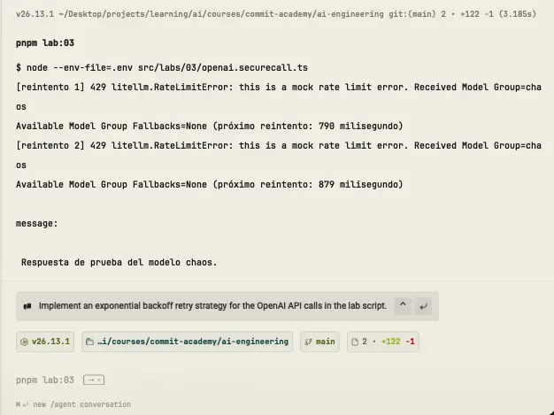
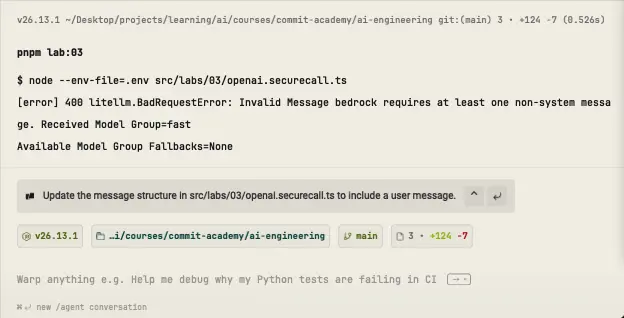
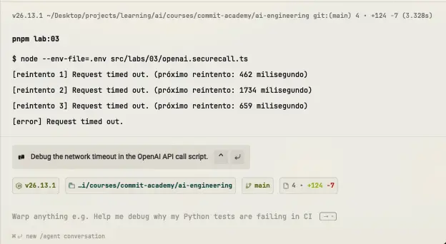
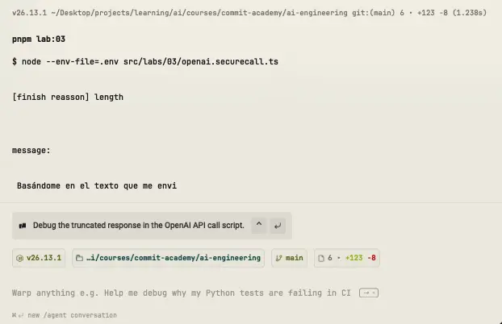

# Lab03

## Cómo funciona el proyecto e instalaciones

Cómo instalar el proyecto, pasos previos:

1. Haz una copia del archivo `.env.template` y renómbralo a `.env`.
2. Busca las variables de entorno dentro de la academia de `commit academi``
3. Instala las dependencias con `pnpm install`

Cómo funciona el proyecto:

La base de este proyecto está en el archivo `onpenai.securecall.ts` y para ejecutarlo, solo tienes que usar el comando `pnpm lab:03`.

Para poder ver los distintos outputs y errores, necesitas modificar tanto los inputs que le pasas a la función `useOpenai` como a la función `withRetries`:

```ts
const response = await withRetries(() => useOpenai(chaos_input), {
	maxAttempts: 4,
});
```

**useOpenai()**:

Como parámetros válidos tiene:

- `params`:

  es el único objeto obligatorio y es el que le dice a la API qué modelo usar y qué tantos tokens de salida se le permiten (también se le pasa el system prompt y el prompt pero estos parámetros para el ejercicio no son modificables ya que son constantes por lo que lo he abstraido en una función a parte).

  Para este ejercicio existe 2 opciones de objetos (obligatorios) que puedes pasarle como primer parámetro a la función `useOpenai` dependiendo del modelo que quieras usar. En ambas se puede modificar el `maxTokens` (por defecto es 256):
  - `chaos_input`: usa el modelo `chaos`
  - `fast_input`: usa el modelo `fast`

  Un ejemplo de cómo se vería el objeto que le deberías pasar sería usando el modelo `chaos` y un límite de `maxTokens`de 50:

  ```ts
  const chaos_input: ProvidersParams = {
  	...PROMPTS,
  	model: useChaos,
  	maxTokens: 50,
  };
  ```

- `emptyMessage`

  Esta es un parámetro booleano opcional que, si se le manda (true), el mensaje que le llega a la API es un mensaje vacio ([]). Esto es opcional porque no se le debería pasar un message vacio a la API pero uno de los ejercicios propone que se le pueda hacer para ver el error.

  La función `useOpenai` se vería así:

  ```ts
  const response = await withRetries(() => useOpenai(chaos_input, true));
  ```

  Al ser opcional, si no se le pasa nada, será false y el mensaje nunca se le pasará vacio.

- `timeoutMs`

  Es el último parámetro que podría recibir `useOpenai` y este modifica el tiempo máximo de espera antes de que mi sistema corte la conexión. El objeto que lo contiene son las `requestOptions` y dentro está el `timeoutMs` que modifica este tiempo que está esperando el sistema antes de cortar la conexión. Se mide en milisegundos y por defecto, si no se le pasa, son 3000.

  Con los 3 parámetros se vería algo como:

  ```ts
  const response = await withRetries(() =>
  	useOpenai(chaos_input, true, { timeoutMs: 4000 }),
  );
  ```

**withRetries()**:

Esta función como parámetro obligatorio tiene que recibir siempre una función y como segundo parámetro (opcional) recibe un `retryOptions` la cual tiene dentro el `maxAttempts`. Es un número entero positovo que dictará la cantidad máxima de intento que hará mi applicación antes de cortar la conexión al proveedor de AI y lanzar el error de por qué no se ha podido establecer la conexión.

```ts
const response = await withRetries(() => funcion(), {
	maxAttempts: 4,
});
```

### Resolución de los problemas planteados

Para llegar a todas las casuísticas que se proponen en el enunciado, necesitas modificar solo lo que le llega a `useOpenai` ya que los `maxAttempts` de `withRetries` aunque se pueden modificar, el enuncuado propone que sean 4.

- Caso 1: Error pasajero: ejecutar 10 veces el resumidor con MODELO=chaos. Los fallos se reintentan y casi todas las ejecuciones acaban respondiendo.

  Tendrás que creat y pasarle a la función `useOpenai` la siguiente variable:

  ```ts
  const chaos_input: ProvidersParams = {
  	...PROMPTS,
  	model: useChaos,
  };

  const response = await withRetries(() => useOpenai(chaos_input));
  ```

  

- Caso 2: Error permanente: con MODELO=fast, una llamada con la lista de mensajes vacía devuelve un 400 real del servicio, que no se reintenta.

  Tendrás que usar la variable `fast_input`:

  ```ts
  const fast_input: ProvidersParams = {
  	...PROMPTS,
  	model: useFast,
  };
  ```

  Además de psarle a la función `useOpenai` el parámetro emptyMessage, quedando así:

  ```ts
  const response = await withRetries(() =>
  	useOpenai(fast_input, { emptyMessage: true }),
  );
  ```

  

- Caso 3: Servicio que no responde: con un timeout de 0,001 segundos, el resumidor reintenta, se agota y termina con un error claro.

  Aquí tienes que pasarle a la función `useOpenai` el objeto con el parámetro `timeoutMs` con un valor de 10. Al ser tan poco tiempo, es indiferente que uses `fast_input` o `chaos_input` pero ten en cuenta que, fast consume cuota ya que la petición se hace aunque no le des tiempo al modelo de responder.

  Quedaría:

  ```ts
  const response = await withRetries(() =>
  	useOpenai(chaos_input, { requestOptions: { timeoutMs: 1 } }),
  );
  ```

  

- Caso 4: Respuesta cortada: con un tope de 10 tokens, el resumidor avisa del corte.

  Aquí tendrías que modificar el objeto obligatorio que se le pasa al modelo. Al ser un corte por máximo de tokens, nacesitas pasarle el modelo fast obligatoriamente.

  ```ts
  const response = await withRetries(() =>
  	useOpenai({ ...fast_input, maxTokens: 10 }),
  );
  ```

  

Cuestiones:

1. **Cuántas de las 10 ejecuciones con chaos necesitaron reintentos y si alguna se rindió**: el modelo chaos en ningún momento se rindió. Hubo unas cuantas situaciones en lo que tuvo que hacer 1 y 2 intentos pero acabó siempre dando como respuesta: _Respuesta de prueba del modelo chaos._

2. **Por qué las esperas entre reintentos tienen que ser aleatorias**: se hacen para evitar que se hagan todas las peticiones en el mismo instante de tiempo. Imagina que has tenido un error en un servicio de tu API y tienes 10k usuarios intentanto acceder a este recurso cada 2 segundos, cunado el servidor/servicio está intentando recomponerse, le vuelven a llegar esas 10k peticiones de golpe pudiendo hacer que se caiga de nuevo. Con los reintentos aleatorios distribuimos (aleatoriamente) esa misma cantidad de peticiones en una cantidad de tiempo mayor. Como segunda medida de protección contra el servicio, por cada reintento de petición, el tiempo aumenta en una cantidad X para así poder distribuir las mismas peticiones aún en una mayor cantidad de tiempo.

3. **Por qué has desactivado los reintentos de la librería**: para poder controlar la cantidad de reintentos dependiendo del error que lo haya causado. Por defecto, la API tiene 2 reintentos por petición pero en algunos casos, como errores 4xx (excepto 429, 408 y 409), no tiene sentido volve a reintentarlo si no se ha corregido el error. Evitamos el reintentos absurdos y manejamos cuándo la cantidad de reintentos cuando tenga sentido hacerlos.

## Utilidades obtenidas de claude para entender cómo hacerlo

- [https://github.com/openai/openai-node#handling-errors](https://github.com/openai/openai-node#handling-errors)
- [https://github.com/openai/openai-node/blob/main/src/core/error.ts](https://github.com/openai/openai-node/blob/main/src/core/error.ts)
- [https://developers.openai.com/api/docs/guides/error-codes](https://developers.openai.com/api/docs/guides/error-codes)
